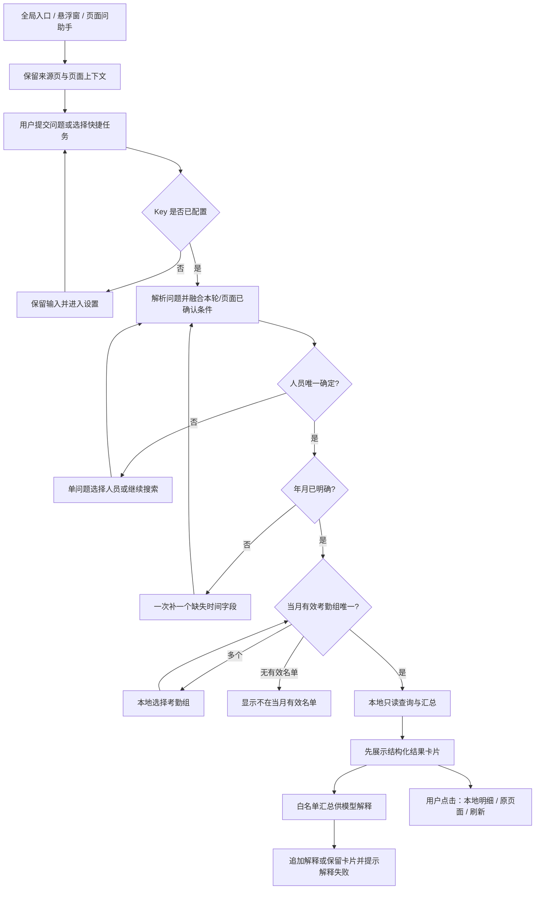

# QingSongBan 智能助手首期交互流程与页面状态规范 v1.0

> 已被[对话优先版 v1.1](智能助手首期交互流程与页面状态规范_v1.1.md)替代。本稿作为历史设计保留，不再作为后续开发主线。用户指出逐步查询流程操作繁琐，已确认改为一句话直接回答，并允许缺少年份时按上下文/今年解析。

> 日期：2026-10-17  
> 阶段：交互流程、页面状态、低保真线框；尚未进入最终视觉与 Flutter 实现。  
> 范围依据：[首期场景与业务 Tool 契约 v1.0](首期场景与业务Tool契约_v1.0.md)  
> 配套预览：[可点击低保真线框](wireframes/智能助手首期交互线框_v1.0.html)（可独立用浏览器打开，无网络依赖）。

## 1. 目标、边界与设计默认值

本轮把已确认契约转化为能走查、能交给 UI/开发人员的交互规范。设计覆盖个人月度考勤、单车年度维修费用、全车年度维修费用排名，保持本人自用、单 DeepSeek、业务只读、默认仅发送必要汇总。

本文不调整统计口径和外发白名单。考勤卡片使用“请假与休息合计”；车辆金额使用“按报修年份统计已完成维修单实际金额”。姓名、车牌等由本地卡片显示。展开本地明细不发送明细给模型。

本轮确定以下交互默认值，作为后续视觉稿的输入，可在不改变契约的前提下细调：

- 一个会话同时只有一项运行中任务；允许编辑下一条输入草稿，运行中先停止当前任务再发送，避免重复提交。
- 澄清一次只问一个必要问题，提供选项和自定义输入；选择后点击“继续”，不把预选项当作用户确认。
- 浮窗展开是会话的便捷视图，独立助手页用于长列表、历史、密钥配置和详细授权；视图切换保留会话、输入草稿、查询条件和滚动位置。
- 结果卡片先于模型解释显示；模型解释失败不能把本地成功结果变成失败页。
- 打开页面、切换视图、恢复历史、选择候选或展开本地明细，都不自动发起新的收费模型请求。只有用户提交问题、明确重试解释/连接测试/明细发送时才调用。
- 本地条件修改与业务刷新可直接完成确定性查询；若需要重新生成模型解释，提供独立动作，不因修改或刷新暗中重复调用模型。

用户确认澄清条件后继续执行，属于原先已提交任务的后续步骤，其必要查询/模型调用计入原任务；这里的“不自动请求”禁止的是额外重启、重复提交或未经用户发起的新任务，不阻断原任务完成。

预览为可交互的流程示意，不实现自然语言理解、真实网络、密钥存储、设备悬浮窗、路由或数据库。所有业务值使用占位符；模拟操作和重置仅改变浏览器内存，刷新页面恢复初始状态。

## 2. 入口与信息架构

| 入口 | 位置与动作 | 初次进入 | 再次进入 |
|---|---|---|---|
| 全局入口 | 首页顶栏“智能助手”；不新增底部 Tab | 进入独立助手页 | 恢复当前会话，不自动重发历史问题 |
| App 内悬浮入口 | App 安全区域内的可拖动入口，可隐藏 | 展开紧凑助手面板 | 恢复同一会话，保留当前任务状态 |
| 考勤页面“问助手” | 月考勤表个人行的更多操作 | 携带人员、年月、组的本地上下文 | 当前会话条件冲突时提示选用哪个对象 |
| 单车页面“问助手” | 车辆详情维修/费用区域 | 携带车辆与有效筛选年份；没有年份则后续询问 | 不覆盖既有任务对象 |
| 全车维修“问助手” | 全车维修单页工具区 | 提供“年度维修费用排名”快捷任务 | 选择该任务时明确切为全部车辆 |
| AI 设置 | 现有设置页增加“智能助手设置” | 配置 DeepSeek Key | 修改/移除密钥，不暴露旧明文 |

全局入口是悬浮入口隐藏后的恢复路径。悬浮入口开关放在助手页“更多”中，仅控制 App 内显示；无系统悬浮窗授权入口。首期页面入口仅限上表，不铺到其他业务模块。

拟定页面标识：`A01` 助手会话、`A02` 条件澄清/候选选择、`A03` 本地明细、`A04` 单次外发授权、`A05` 历史会话、`A06` AI 设置。它们是设计标识，非声称已经存在的路由。

## 3. 悬浮窗、全屏与返回规则

### 3.1 悬浮窗表现

- 收起态：单个 48dp 以上触控区域，语义标签“打开智能助手”；显示忙碌/完成状态时同时提供文字语义，不仅用颜色表达。
- 拖动：只在收起入口或展开面板标题的拖动区生效，不抢占消息滚动、按钮点击或 Android 返回手势。位移达到阈值后才判为拖动，结束拖动不触发点击。
- 提供“靠左/靠右”按钮作为拖动替代；拖动不是唯一移动方式。位置按安全区、导航条、系统手势区和键盘重新限制。
- 展开态：顶栏包含“智能助手”、转独立页、收起、更多；消息区单一纵向滚动，输入区固定在可用区域底部。次要顶栏动作在窄屏收入“更多”，不压缩正文或触控面积。
- 展开面板作为模态工作区，轻遮罩阻止误触业务页；背景滚动暂停。用户需收起后操作原页面；面板内按钮不触发背景动作。
- 点击遮罩仅收起，不丢弃草稿、不删除历史、不取消已经提交的只读任务。明确“关闭悬浮入口”则同时隐藏入口，当前运行请求取消并保留已完成卡片。
- 当前 App 页面出现原有弹窗/选择器或系统授权时，助手收起并临时隐藏入口；流程结束恢复，不让助手覆盖原有操作。
- App 切后台时不显示悬浮内容，取消或使运行请求失效；返回前台展示中断状态，可手动重试，不自动重发。

### 3.2 布局约束

手机宽度基线为 390dp，并检查 320dp、375dp、横屏及系统字体放大。面板可用宽度为安全区宽减两侧间距，建议上限 420dp；展开高度以能看见标题、当前条件、输入框和至少一项主操作为下限，不硬锁固定像素高度。

键盘出现后保持输入区和当前操作可见；可用高度不足时转独立助手页并保留状态，不让用户在多个嵌套滚动区间寻找按钮。系统字体放大后操作按钮可换行排列；金额、日期、姓名和关键统计标签不靠缩小字体容纳。

具体颜色、圆角、阴影、图标样式、动效时长与精确尺寸由下一阶段 UI 视觉稿决定，沿用现有 App 设计语言；不引入新的主题/图标依赖或暗色模式功能。

### 3.3 返回与焦点

按当前最上层处理一次返回：系统键盘可见时由系统先收起键盘 → 单次授权/本地明细/候选选择退出当前层 → 浮窗展开态收起 → 独立助手页返回来源页面 → 原页面导航。

从浮窗打开独立页后，返回恢复原浮窗与原业务页；直接从全局入口进入独立页时，返回原业务页的收起入口或隐藏状态。关闭入口不删除会话，删除会话不隐藏入口。

模态打开后焦点进入标题/首个可操作项，关闭后回到触发按钮；独立页或设置表单错误后聚焦首个错误字段。发送结果和加载结束通过状态提示朗读，不持续抢夺输入焦点。正文流式更新不逐字播报。

## 4. 主流程：个人月度考勤

### 4.1 成功路径逐步说明

| 步骤 | 用户看到与操作 | 系统行为 | 离开/失败处理 |
|---|---|---|---|
| 1 打开 | 三个快捷任务、输入框、当前可用页面对象 | 不自动查询，不自动测试 Key | 可收起或返回 |
| 2 提交 | 问题进入消息区，状态“正在理解问题”，可停止 | 校验 Key；有效配置后解析任务 | Key 缺失保留问题转设置；不重复插入消息 |
| 3 补条件 | 只出现一个必要问题，提供选项与自定义输入 | 已知条件不重复问；每次回答后重新计算缺项 | 可取消当前查询或改问新问题 |
| 4 查本地 | 条件条显示人员、年月、组；“正在查询考勤” | 解析本地引用，读取有效名单/月表/加班 | 本地失败提供“重新查询” |
| 5 看结果 | 出勤、请假与休息合计、加班时长；时间与口径 | 数值由结构化结果渲染，模型解释随后追加 | 模型失败仍保留卡片 |
| 6 展开 | 点击“每日明细”或“加班明细” | 只在本地读取，不调用 DeepSeek | 返回保留卡片滚动位置 |
| 7 追问 | 输入“那李某呢？” | 继承年月、任务类型；重新解析人员及该人当月组，不沿用前人的组 | 同名再次提供本地选项 |
| 8 看来源 | 点击“查看月考勤表” | 打开已存在页面，沿用年月；精确定位能力按契约缺口处理 | 返回恢复助手结果 |

输入了完整人员、年月且有效组唯一时，省略所有澄清。不是每次都按步骤问一遍。

### 4.2 澄清与条件冲突

- 缺任务类型先选任务，其后按人员/车辆 → 缺失时间字段 → 考勤组的顺序处理；每轮只展示当前必要的一个问题。
- 缺年份：可选“今年（实际年份）”“去年（实际年份）”及“其他年份”；其他年份可用选择器或自定义输入，当前已知月份保留。
- 缺完整月份：先选择年份，再选月份；如本轮或页面已有年份，不重复问年份。
- 同名候选：显示本地姓名、人员编号和班组/区域，单选后“继续”；未选时禁用继续，候选超过一页支持本地搜索/加载，不发送候选清单。
- 页面对象与已有会话对象冲突且本次输入无明确对象：显示“继续查询〔会话对象〕”和“切换到〔当前页面对象〕”，不默认替换；对象已明确则不弹确认。
- 各选择器均允许返回上一步或“取消本次查询”。取消不清空已有消息；若用户改问新任务，替换未提交条件，旧任务标记已取消。
- 自定义输入在当前问题内提交，不要求用户重新输入整句。无效年份/月在字段附近提示，保留输入，不回落到当前日期。

## 5. 车辆查询与排名的复用流程

### 5.1 单车年度维修

沿用第 4 章的实体选择、时间补齐、查询和结果结构，替换为车辆和年份。车牌/车辆编号只在本地候选与卡片中出现。

卡片按优先级展示：车辆标签＋年份 → 实际维修费用 → 已完成维修单数 → “按报修年份统计已完成维修单实际金额” → 查询时间 → “维修单明细”“查看原页面”“刷新”。费用为零但有单时保留实际单数，不能展示成无记录。

“今年修了几次”按已完成单数回答，并在同一结果上说明口径。用户要求全部报修次数、支付或结算口径时提示首期范围，并提供原页面，不擅自变更过滤规则。

### 5.2 全车年度维修费用排名

选择快捷任务后清除单车限制，保留明确年份。先完整集合聚合，再展示每页排名；每行包含本地车辆标签、名次、实际金额和已完成单数。窄屏用上下两行排列，不压缩成长横表。

首屏标注“当前显示 X / 总计 Y 辆”，底部“加载更多”只读取同一排名快照，不自动要求模型重新解释。模型解释仅覆盖已发送的匿名行；第一名判断来自本地完整排名。并列费用名次为 `1、1、3`，相同金额有稳定顺序。

点击排名项进入单车同年份汇总；返回保留排名、页数与滚动位置。追问“第一辆”依据本地映射解析；第一名有并列时提供并列车辆选择，不能静默取第一行。刷新重新聚合并重置旧分页，旧结果留在历史消息中。

## 6. 页面和区域结构

| 页面/区域 | 必备内容 | 主动作 | 退出后的状态 |
|---|---|---|---|
| A01 会话起始 | 三类快捷任务、当前页面对象提示、输入标签、发送说明、历史/设置入口 | 发送问题 | 保留未提交草稿 |
| A01 查询过程 | 原问题、当前条件、阶段提示、停止 | 停止 | 已完成卡片保留 |
| A02 单问题 | 问题标题、已知条件摘要、候选/选择器、自定义输入、继续/取消 | 继续 | 回到同一任务，不插入重复问题 |
| A01 考勤卡片 | 本地人员/年月/组、三项汇总、口径/时间/完整性提示 | 每日明细 | 回到卡片原位置 |
| A01 车辆卡片 | 本地车辆/年、金额/已完成单数、口径/时间 | 维修单明细 | 保留车辆及年份 |
| A01 排名卡片 | 年份、集合范围、排名行、分页状态、无记录说明 | 点选车辆或加载更多 | 保留排名位置 |
| A03 本地明细 | 对象/时间/本地查看标签、记录列表、数据时间、返回 | 请求分析这些明细 | 本地展开本身不外发 |
| A04 单次授权 | DeepSeek、对象/时间、字段清单、记录数量、实际内容预览 | 本次发送 | 取消/退回视为未授权 |
| A05 历史 | 会话标题、本地保存说明、最后使用时间、删除操作 | 打开会话 | 恢复历史，不自动刷新/重发 |
| A06 AI 设置 | Provider=DeepSeek、Key 配置状态、掩码输入、显示切换、测试、保存/移除 | 保存 | 返回原任务，需用户点击继续/重试 |

会话顶栏的历史、设置、更多动作可折叠；保持唯一主动作。不在首期显示语音、图片识别、第二 Provider、自动路由、草稿保存或系统悬浮授权入口。

## 7. 明细与单次外发授权

本地明细页固定标注“仅本地查看，尚未发送这些明细”。用户点击“分析这些明细”后先进入 A04，不能直接开始网络请求。

授权字段按契约限定：考勤日期/上午下午状态、加班日期/分钟；维修日期/完成日期/状态/实际金额；费用数量/单位/单价/小计及匿名项目序号。身份、内部 ID 和自由文本不加入授权开关。

授权流程：

1. 展示当前对象、时间、快照与记录范围，用户可选择允许的字段和记录子集。
2. 本地构造匿名投影，展示实际待发送内容预览和条数；无选中字段/记录时不能发送。
3. 按钮明确为“仅本地查看”和“本次发送给 DeepSeek”；取消、遮罩关闭和返回都不发送。
4. 点击发送后绑定本次 Provider、对象、快照、字段和记录；输入变化/刷新导致预览变化时旧授权作废。
5. 失败重试重新显示同一请求的授权预览，不能沿用“已经确认过”跳过；后续普通追问也不回放这批明细。

面板使用足够空间展示预览，手机上为全高弹层/独立页；浮窗内触发时暂转独立助手工作区，结束后返回原浮窗。不用狭小二次弹窗承载长字段和长列表。

## 8. 页面状态与恢复动作

| 状态 ID | 用户提示/表现 | 可执行动作 | 数据/请求处理 |
|---|---|---|---|
| ST01 起始 | “想查询什么？”三类快捷任务 | 输入/选任务/历史/设置 | 不自动请求 |
| ST02 缺 Key | “请先配置 DeepSeek API Key，问题已保留” | 去配置/取消 | 不丢输入，不写入消息日志中的 Key |
| ST03 澄清 | 当前一个必要问题 | 选项/自定义/继续/取消 | 下游查询暂停 |
| ST04 理解中 | “正在理解问题” | 停止；编辑下一条草稿 | 禁用重复发送 |
| ST05 本地查询 | “正在查询〔对象与时间〕” | 停止 | 不提前显示零值或假总结 |
| ST06 卡片成功 | 真实本地数值、查询时间 | 明细/来源/刷新/追问 | 模型解释可稍后完成 |
| ST07 解释失败 | 卡片保留，“汇总已查到，文字解释未完成” | 重试解释/来源 | 重试仅发允许汇总，不重跑业务写入 |
| ST08 本地失败 | “未能读取本地记录，请重试” | 重新查询/原页面 | 不使用空卡片冒充成功 |
| ST09 无记录 | “该口径下暂无已完成维修单”等具体说明 | 改时间/原页面 | 区别零金额有单；不评判业务状态 |
| ST10 不在名单 | “不在该月有效考勤名单，无法按月表统计” | 改月份/查看名单来源 | 不返回零出勤成功结果 |
| ST11 未登记/完整性未评估 | “当前已登记汇总；完整性未评估” | 本地明细/来源 | 不把未登记当缺勤或正常 |
| ST12 超出范围 | “首期支持考勤与车辆年度维修查询”并解释具体限制 | 支持任务/原页面 | 不编造或跨模块执行 |
| ST13 已停止/后台中断 | “已停止，本地已完成结果已保留” | 重新查询或重试解释 | 请求失效，迟到响应不得覆盖 |
| ST14 历史结果 | “历史查询·查询于〔时间〕” | 刷新/继续对话 | 恢复本身不请求；不冒充最新 |
| ST15 结果失效 | “记录已变化或引用失效，请刷新后继续” | 刷新 | 不拼接旧汇总与新明细 |
| ST16 明细授权 | 实际字段/匿名内容/数量/接收方 | 本次发送/仅本地查看 | 不存在默认长期授权 |
| ST17 Key 无效/限流 | 明确密钥/调用问题，不显示 Provider 原始响应 | 设置或稍后重试 | 保留问题与本地卡片 |

阶段提示用于说明当前发生什么，不显示无法测量的虚假百分比。加载期间的首要操作是停止，失败后首要操作是恢复；不堆叠多个“重试”而让用户猜测将重试哪一层。

刷新和解释区分：刷新重读本地结果，标记旧解释对应旧快照；“重新解释”才发送新汇总。展开收起、加载本地下一页和跳转来源不自动重发模型调用。

## 9. 历史与设置的具体行为

历史列表按最近使用排序，标题来自任务与时间的本地摘要，不调用模型起名。打开后保留旧卡片、查询条件与时间；继续查询重新读数据。删除会话需一次确认，说明只删除助手历史；设置中“清空助手历史”单独确认，不触碰业务记录或 API Key。

配置 Key 时允许粘贴，默认掩码，显示开关有明确标签；不回填旧明文，不在消息/浏览器控制台/日志中显示 Key。保存只更新安全配置，不自动提交原问题；“测试连接”由用户主动点击，提示会发起一次测试请求。移除密钥单独确认，完成后保留本地历史与已取得结果。

本地预览不接受真实 Key：设置页仅展示禁用占位输入和模拟状态，按钮注明为模拟。产品实现时才能接入安全存储与真实测试，预览不得让用户误以为完成了连接或保存。

## 10. 低保真预览与走查方法

预览含“交互走查”和“线框总览”两种模式；总览用于并排核对结构，单页走查用于检查动作与状态衔接。预览顶部有明确“设计预览/占位数据”标识，不把流程模拟当作运行证据。

| 线框 | 对应页面/状态 | 必须能说明的事情 |
|---|---|---|
| WF01 起始 | A01/ST01 | 入口、三类任务、问题输入、历史与设置 |
| WF02 补年份 | A02/ST03 | 一次只问一个问题，选项与自定义输入 |
| WF03 同名选择 | A02/ST03 | 本地身份信息、单选、继续与取消 |
| WF04 考勤结果 | A01/ST06 | 三项汇总、统计标签、解释与本地事实分区 |
| WF05 每日明细 | A03 | 本地标签、日期/状态、返回与分析入口 |
| WF06 单车结果 | A01/ST06 | 报修年、已完成单、实际金额口径 |
| WF07 排名 | A01/ST06 | 并列、分页覆盖、单车下钻与返回 |
| WF08 外发确认 | A04/ST16 | 明细预览、字段/条数、单次发送/取消 |
| WF09 失败恢复 | A01/ST07 | 卡片成功但解释失败，重试层次明确 |
| WF10 悬浮入口 | 宿主页面/收起展开 | 背景、拖动、靠左/右、收起关闭与转全屏 |
| WF11 历史 | A05/ST14 | 历史标识与刷新，不自动调用 |
| WF12 设置 | A06/ST02/ST17 | Key 掩码、安全说明、模拟连接与返回 |

另可直接检查考勤组选择、加载/停止、空数据、不在名单、结果失效和导航来源占位。输入框用于保留交互草稿，预览通过场景切换演示流程，不承诺解析任意文本。

建议走查顺序：起始 → 考勤快捷任务 → 补年份 → 同名选择 → 考勤组选择 → 本地查询 → 考勤卡片 → 每日明细 → 外发确认取消 → 回卡片；再走排名 → 单车 → 维修明细 → 来源返回；最后检查模型失败、历史恢复、Key 缺失和浮窗。

## 11. 下一阶段 UI 与开发交接

### 11.1 UI 视觉设计输入

UI 稿至少覆盖 WF01～WF12 及关键空/错误状态，统一三类卡片与选择器；按 390dp 主稿补 320dp 窄屏、横屏/键盘和字体放大布局。现有 App 主题与组件是视觉来源，本轮灰阶线框不形成新品牌规范。

触控区域按 Android 48dp 起设计，邻近动作保持间距；正文与金额可换行，长身份标签提供完整查看。输入字段有可见标签，图标按钮有动作名称；候选选中、失败和历史不能只靠颜色识别。动画尊重系统减少动效设置，不阻塞输入。

### 11.2 开发状态交接

开发至少区分四类独立状态：`PresentationState`（隐藏/收起/展开/全屏）、`TaskState`（理解/澄清/查询/成功/失败/取消）、`ResultState`（快照/历史/失效）、`DisclosureState`（本地明细/待确认投影/单次发送）。收起界面不能等同于任务取消，模型失败不能等同于本地查询失败。

关键事件包括：打开/收起/隐藏、提交/停止、回答当前问题、选择实体/组、切换页面上下文、本地查询完成、模型解释完成/失败、展开明细、申请/取消/确认外发、刷新、来源跳转/返回、恢复/删除历史、Key 保存/移除。每个异步事件绑定任务标识，取消后旧事件不更新新任务。

路由细节依照业务契约现有缺口明确设计：不得假称已有人员精确定位、考勤组参数、维修年份初始化。原页面无法保留筛选时在跳转前说明，不提供看似保留但实际丢失的年份。

## 12. 交互验收与本轮证据边界

| 检查项 | 通过条件 |
|---|---|
| 减少重复输入 | 页面已确定对象/年月时不再询问；追问正确继承适用条件 |
| 澄清便捷 | 同时只出现一个必要问题；有选项和自定义输入，不要求重打整句 |
| 数值可核对 | 考勤合计、已完成单数、报修年口径清晰；本地事实不依赖模型文本 |
| 明细外发 | 本地查看不发；取消不发；字段/范围可预览；重试重新确认 |
| 浮窗 | App 内单实例、可收起/移动/隐藏，存在恢复入口，不挡键盘及原页面关键动作 |
| 返回与连续性 | 候选/明细/授权/来源逐层返回，草稿、条件和滚动位置按规则保留 |
| 错误恢复 | 解释失败保留本地卡片；失败与无记录区分；停止后迟到响应无效 |
| 历史与配置 | 历史不冒充最新、不自动外发；Key 不出现在对话中，保存不自动发问题 |
| 适配与可访问性 | 320dp 与字体放大不截断关键内容；可见焦点；非拖动移动入口；读屏顺序明确 |

本轮交付包括本文和本地 HTML 线框；通过本地静态检查和浏览器走查后可作为设计评审材料。它不代表 Flutter 已实现、DeepSeek 已接通、真实密钥已存储或设备悬浮/返回/键盘行为已通过验证；这些在实现与设备验收阶段分别记录。

方法说明：本轮参考 ui-ux-pro-max 的触控、焦点、渐进披露与错误恢复建议，并以业务契约约束范围。其本地 Flutter 数据集对 `safe area overlay keyboard` 和 `SafeArea` 两次查询均无匹配；安全区/键盘条款采用契约与通用移动端设计约束，未宣称检索得到具体 Flutter API 实现方案。

## 13. 本轮交付检查记录

日期：2026-10-17。以下为本地 HTML 预览检查，业务值均为占位，不代表 App 功能通过验收。

| 检查 | 结果与证据 |
|---|---|
| JavaScript 语法 | 使用 Node.js `--check` 检查内联脚本 |
| 自定义年份主线 | 浏览器选择自定义年份并填入 2025，继续后人员选择页保留 `2025-09`；人员确认后再选择考勤组，随后进入查询与明细 |
| 明细与授权取消 | 每日明细显示仅本地查看；请求分析进入授权页；取消后返回明细并可回汇总 |
| 字段为空 | 取消全部字段后，发送按钮禁用，预览显示不会发送任何字段 |
| 排名连续性 | 加载第二页 → 单车结果 → 返回排名，仍保留第 1～2 页 |
| 模型解释失败 | 本地占位卡片与解释失败提示并存，重试后回结果展示 |
| 悬浮连续性 | 靠左入口可打开同一会话；悬浮转全屏再返回，恢复原悬浮面板 |
| 320dp 结构 | 切换到 320dp，DOM 尺寸检查中手机容器、顶栏、消息区和输入区均无横向溢出；不等同于 Android 字体缩放或键盘验收 |
| 预览截图 | [320dp 澄清状态截图](wireframes/智能助手首期交互线框_预览.png)；截图保留设计标识与上下文 |
| 外部依赖 | HTML 无外部脚本、无 `fetch/XMLHttpRequest/WebSocket`，不读写浏览器持久存储 |
| 本地文档 | 交付前检查 Markdown/HTML 相对链接、代码块闭合及 UTF-8 编码 |
| 尚未验证 | 真实 DeepSeek、真实 Key 安全存储、Flutter 状态、设备系统返回/键盘/字体缩放/读屏、真实业务数据和耗时 |

当前应用浏览器禁止直接导航 `file:` URL，因此浏览器走查通过仅绑定 `127.0.0.1` 的本地 HTTP 预览完成；没有尝试绕过该限制。HTML 保持独立文件交付，不依赖此服务器或真实网络接口。
